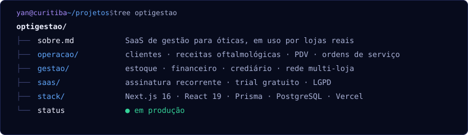
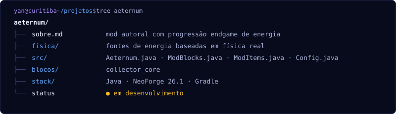
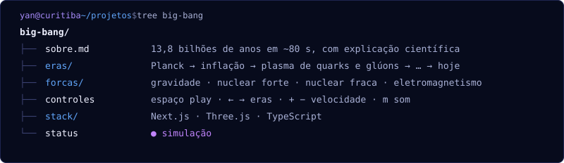
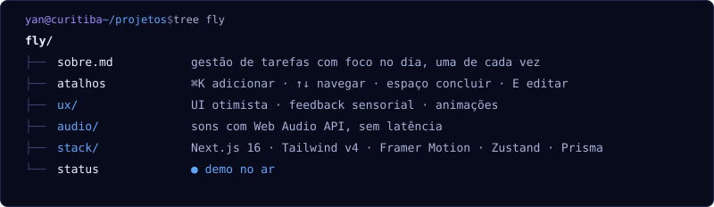
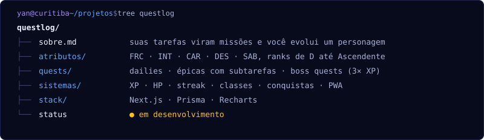
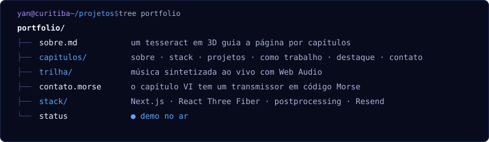

<p align="center">
  
</p>

<p align="center">
  
</p>

Oi, eu sou o Yan. Tenho 21 anos e estudo Ciência da Computação em Curitiba.
Escrevo software que gente de verdade usa (meu SaaS roda hoje no balcão de óticas) e, no tempo que sobra, tento entender o universo. O plano é fazer doutorado em física de plasma na França.

<p>
  
</p>

### `~/projetos`

<sub>clique numa pasta para abrir</sub>

<details>
<summary><picture></picture></summary>
<picture></picture>

↳ [repositório](https://github.com/YanMachadoNunes/optigestao)
</details>

<details>
<summary><picture></picture></summary>
<picture></picture>

↳ [repositório](https://github.com/YanMachadoNunes/aeternum)
</details>

<details>
<summary><picture></picture></summary>
<picture></picture>

↳ [repositório](https://github.com/YanMachadoNunes/big-bang)
</details>

<details>
<summary><picture></picture></summary>
<picture></picture>

↳ [repositório](https://github.com/YanMachadoNunes/fly) · [abrir o app](https://fly-weld.vercel.app)
</details>

<details>
<summary><picture></picture></summary>
<picture></picture>

↳ [repositório](https://github.com/YanMachadoNunes/QuestLog)
</details>

<details>
<summary><picture></picture></summary>
<picture></picture>

↳ [repositório](https://github.com/YanMachadoNunes/Portifolio) · [abrir o site](https://yanmachado.vercel.app)
</details>

### `~/agora`

```text
construindo   optigestão   → crediário e planos por assinatura
modando       aeternum     → sistema de energia no NeoForge
estudando     física de plasma · simulação numérica
destino       doutorado em física de plasma, França
```

### `~/números`

<p>
  
  
</p>

### `~/contato`

[LinkedIn](https://www.linkedin.com/in/yan-machado-nunes-78a7a2353/) · [yan05012005@gmail.com](mailto:yan05012005@gmail.com) · [yanmachado.vercel.app](https://yanmachado.vercel.app)
